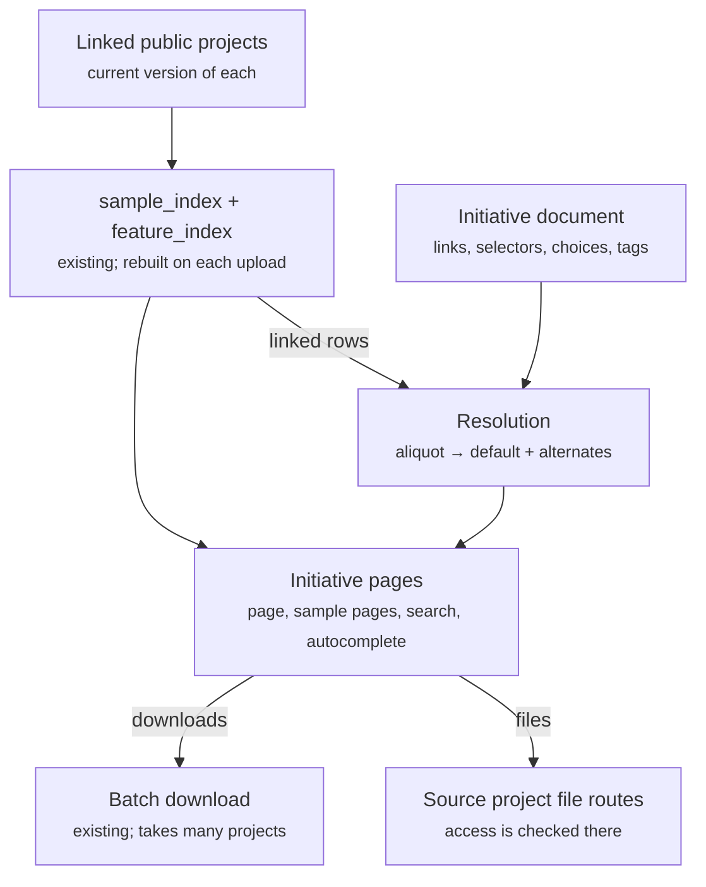

# Initiatives: design and decisions (#697)

As of 2026-10-31.

An initiative is a synthetic project that gathers the samples of one cohort on
one reference build from public projects. It shows each tumour aliquot once and
keeps every other analysis of that aliquot as an alternate. It replaces the
"umbrella" first proposed in
[#697](https://github.com/AmpliconSuite/AmpliconRepository/issues/697).
"Initiative" is a working name, not final.

| Decision | Settled as |
| --- | --- |
| What an initiative is | A synthetic project that acts almost completely like a project: its own page, sample pages, search, downloads |
| First initiatives | TCGA GRCh37, TCGA GRCh38, PCAWG, DepMap (CCLE + DepMap) |
| Reference builds | One build per initiative; the same aliquot in the other build is a cross-link, not a merge |
| Membership | Per sample: a linked project contributes all of its samples, or only those carrying the initiative's ID (GLASS gives only its TCGA samples) |
| Which project version contributes | The current version of each linked project |
| Who may be linked | Public projects only, never hidden or private |
| Sample identity (TCGA) | The tumour aliquot (28-character barcode) |
| Default analysis when an aliquot has several | The pairing used in TCGA filtered; otherwise an admin's choice |
| Versions | Created only when an admin tags one; re-applying AC never creates one |
| Editing | A reduced, initiative-specific edit form |
| Coamplification graph | Needs updating for initiatives; lower priority |

## Three relations between samples

Two samples can be related in three ways, and only the first is a true
duplicate. Keeping the three apart is what keeps the backend simple.

| Relation | Example on prod | Results | How the initiative treats it |
| --- | --- | --- | --- |
| Duplicate: one analysis stored twice | PCAWG inside PCAWG unfiltered (2,095); TCGA inside TCGA unfiltered (101) | Identical features in every case | One row; counted once |
| Same aliquot, analysed again | Another matched normal (297 TCGA aliquots); GLASS's TCGA samples; PCAWG's TCGA donors; the other build | Often differ: 6 of the 297 change ecDNA yes/no | One row per aliquot, showing the default analysis; the others are alternates on its sample page |
| Same patient, different sample | A patient's primary and recurrence; sibling PCAWG specimens of one donor | Different tumours | Separate rows; a later "same patient" link, never merged |

Fuzzy name matching ranks autocomplete suggestions and never decides identity.
At edit distance 1 it pairs COLO205 with COLO-320, two different cell lines.

## The initiative

An initiative is one cohort on one reference build, assembled per sample from
linked public projects, and it reads like a project. An admin links a project to
it with a selector. The project's current version then contributes whichever of
its samples the selector picks.

- **Selectors:** all samples; samples carrying the initiative's ID (a TCGA
  barcode, an ICGC donor/specimen ID, a DepMap ACH ID); or an explicit list.
- **One build per initiative.** The aggregator refuses a project with two
  reference builds ("AmpliconRepository only supports single-reference
  projects"), and the coamplification graph will not mix hg19 and hg38. A
  per-build initiative needs no mixed-build work.
- **Public only.** The link form offers public projects alone. A linked project
  that later turns hidden or private drops out, and the edit page says so.
- **A project can feed several initiatives,** and a sample can sit in more than
  one. A PCAWG TCGA donor is in PCAWG and is an alternate analysis in TCGA GRCh37.

| Initiative | Linked projects and selector | Rows | Initiative samples |
| --- | --- | --- | --- |
| TCGA GRCh37 | TCGA unfiltered (all); GLASS (TCGA IDs); PCAWG unfiltered (TCGA IDs) | 2,471 + 34 + 794 | about 2,161 tumour aliquots: 2,155 + 6 from PCAWG; GLASS adds 0 or 2 |
| TCGA GRCh38 | GRCh38 TCGA projects, once public | — | — |
| PCAWG | PCAWG unfiltered (all) | 2,908 | 2,908 |
| DepMap | CCLE (all); DepMap (all) | 329 + 476 | 805; the two share no DepMap ID |

The TCGA GRCh37 count assumes the 788 PCAWG aliquots already in TCGA
unfiltered become alternates. It also assumes the 32 GLASS aliquots that match
a single candidate merge into theirs. GLASS's 2 ambiguous aliquots stay
separate until resolved.

## Sample identity and the default analysis

A TCGA initiative row is one tumour aliquot, and every analysis of that aliquot
hangs under it. The sample page shows the default analysis with a switcher to
the others. The initiative counts the aliquot once.

**How each source yields an aliquot**

| Source | Its name or metadata | Aliquot from |
| --- | --- | --- |
| TCGA unfiltered | `TCGA-05-4389-01A-01D-1931-08_MN_10A-01D-1203` | The name up to `_MN_`; the rest is the matched normal |
| GLASS | `TCGA-06-0152-TP-02D-WGS-6HJBZJ` (GLASS's own form) | Patient + tumour type (TP→01, R1→02) + portion/analyte (02D): unique for 32 of 34 |
| PCAWG | `DO22145-SP47708` | PCAWG release metadata: specimen → `submitted_sample_id`, the 28-character barcode (801 TCGA donors) |
| A GRCh38 project | GDC barcode in the name | The name |

**Default analysis, in order**

1. The pairing used in TCGA filtered, the curated set cited in Kim 2024. It
   exists for 19 of the 297 multi-normal aliquots.
2. Otherwise, the analysis an admin picks on the edit form.
3. Until an admin picks, the initiative shows the first analysis by sample name
   and marks the row as unreviewed. (A proposal, not yet agreed.)

The default doesn't depend on which normal sits on the tumour's plate, or on
whether a normal has a GRCh38 BAM; every normal involved has one. An aliquot
with a single analysis needs no choice. Across builds the same aliquot is a link
("also in TCGA GRCh38"), because GRCh37 and GRCh38 coordinates cannot share a
page.

## Versioning and the edit form

A tagged version freezes the sample list, while the data shown is always each
linked project's current version. So re-applying AC to a project updates the
initiative's results at once, without a new initiative version.

- **A version is a small manifest:** for each initiative sample, its project,
  sample name and default analysis. It also records the project version each
  sample came from when tagged. No data is copied, and a citation of "TCGA
  GRCh37 v2" can be traced to exact project versions, which the site keeps.
- **Pending changes:** when a linked project's new version adds or removes
  samples, the edit page lists them ("TCGA unfiltered: +12, −1 since v2"). They
  apply when an admin tags the next version.
- **One new rule:** permanently deleting a project version that a tagged
  initiative version names is refused, or at least flagged.

The edit form holds only what an initiative has:

- name and description;
- linked projects (public only), each with its selector;
- the default analysis for each multi-analysis aliquot that TCGA filtered does
  not settle;
- per-sample include and exclude overrides;
- the pending-changes list and the Tag version button.

An initiative has no upload, no reaggregation and no project-member list of its own.

## How it is built

An initiative is a view over the indexes the site already keeps, never a copy of
project data. Two things are stored: the initiative document, and a resolution
derived from it.

New: the initiative document, the resolution and the initiative pages. The
indexes, the file routes and the batch download already exist, and files never
leave their project.

- **Stored:** the initiative document, holding linked projects, selectors, admin
  choices and tagged manifests. Also the resolution, which maps each aliquot to
  its default and alternate analyses. The resolution is rebuilt when an admin
  edits or tags, and by a management command.
- **Pages:** rendered from `sample_index` and `feature_index`, which already
  serve the sample page and search. The initiative gets its own page, its own
  sample pages and a search facet.
- **Files:** served through the source project's routes. GridFS file IDs are
  never copied into an initiative: on prod no file is shared between projects,
  and delete and cleanup rely on one owner per file.
- **Downloads:** the existing batch download, which already takes samples from
  several projects.
- **Counting:** site total = initiative samples + samples in no initiative. TCGA
  GRCh37 turns 3,299 rows (2,471 + 34 + 794) into about 2,161.
- **Autocomplete:** suggestions come from `sample_index` under the same access
  filter search uses. Matching ignores case and punctuation, ranks prefix over
  substring, and allows one typo only for queries of 5 or more characters.

## Measurements behind the decisions

All measured read-only on prod on 2026-10-31, over the current versions of live
public projects.

**Normal pairings: the 297 TCGA unfiltered tumour aliquots with more than one matched normal**

| AC results across the pairings | Aliquots |
| --- | --- |
| Identical: classes, locations, copy number | 185 |
| Same classes and locations, copy number differs | 1 |
| Same classes, locations differ | 46 |
| Classes differ, ecDNA yes/no agrees | 59 |
| ecDNA yes/no differs | 6 |

They account for 316 extra rows: TCGA unfiltered's 2,471 rows hold 2,155 tumour
aliquots from 1,940 patients.

**Overlaps by aliquot**

| Comparison | Result |
| --- | --- |
| PCAWG unfiltered TCGA aliquots in TCGA unfiltered | 788 of 794; 6 in neither TCGA unfiltered nor GLASS |
| PCAWG unfiltered specimens not resolvable | 11 from US (TCGA) projects without a barcode; 119 absent from the PCAWG metadata |
| GLASS TCGA samples matching one GDC aliquot | 32 of 34; their AC agrees on classes for 25, on ecDNA yes/no for all 32 |
| TCGA unfiltered tumour aliquots with a GDC GRCh38 WGS BAM | 2,126 of 2,155 |
| CCLE and DepMap cell lines in common (DepMap ID) | 0 |

The GRCh38 list is 23,723 GDC harmonized WGS aliquots, compiled with Biomni.
The PCAWG map is the lab's `PCAWG_original_metadata_with_simplified_ctype.csv`
(the PCAWG release sample sheet).

## Open items and later work

- [ ] **Two GLASS samples:** `TCGA-FG-5965-R1-11D-WGS-YWHSSO` (vial 02A or 02B)
  and `TCGA-DU-5872-TP-11D-WGS-WTQAIF` (plate 1703-02 or A465-08). GLASS's legacy
  aliquot mapping isn't public. Two ways to get it:
  - join GLASS's Synapse `analysis_files` table (syn69931146) to the legacy BAM
    checksums, which needs a Synapse login;
  - ask GLASS for `glass_wg_aliquots_mapping_table.txt`.

  Until then they stay separate rows.
- [ ] **Unresolved PCAWG specimens:** 130 of PCAWG unfiltered (11 without a
  barcode, 119 outside the metadata) may include TCGA donors.
- [ ] **Agree step 3 of the default analysis:** what an initiative shows before
  an admin has picked.
- [ ] **Coamplification graph for initiatives:** lower priority.
- [ ] **"Same patient" links** across initiatives and cohorts: later, from
  curated mappings only.
- [ ] **GRCh38 re-run of the legacy set:** possible for 2,126 of TCGA
  unfiltered's 2,155 tumour aliquots, which have a GRCh38 BAM.

Sources:
- [fpbarthel/GLASS `gdc-create-manifest.R`](https://github.com/fpbarthel/GLASS/blob/master/R/manifest/gdc-create-manifest.R), read directly.
- The following come from Biomni's answers and were not checked directly:
  - the GLASS Synapse tables ([syn17038081](https://www.synapse.org/Synapse:syn17038081/wiki/585717));
  - the GDC GRCh38 aliquot list;
  - the [GDC Legacy Archive retirement](https://gdc.cancer.gov/news-and-announcements/gdc-legacy-archive-retires).
